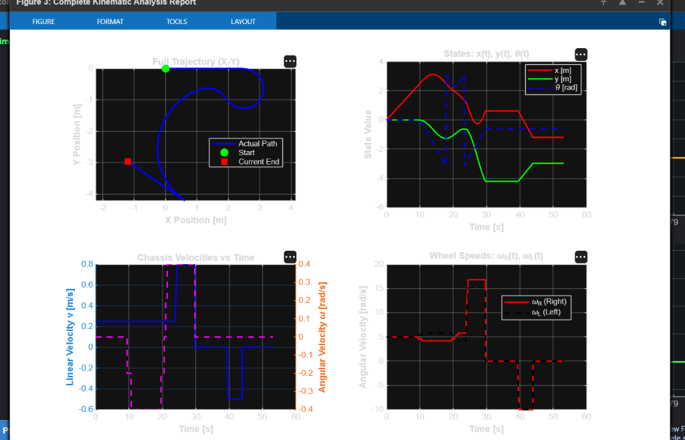

# Kinematic Analysis and Real-Time Simulation of a Differential Drive Wheeled Mobile Robot

[](https://matlab.mathworks.com/open/github/v1?repo=saimanikantanagabandi/differential-drive-robot-kinematics&file=diff_drive_moving_simulation.m)
[](https://saimanikantanagabandi.github.io/differential-drive-robot-kinematics/)

A simulation and kinematic analysis framework for a two-wheeled differential drive mobile robot (DDMR). Implements forward and inverse kinematics, 4th-order Runge-Kutta (RK4) numerical integration, closed-loop waypoint tracking, interactive manual driving, and comprehensive diagnostic reporting.

---

## ⚡ Instant One-Click Run (No Installation Required)

You can run and interact with this project in two ways directly from this GitHub page:

1. **Run in MATLAB Online**:
   Click the **[Open in MATLAB Online](https://matlab.mathworks.com/open/github/v1?repo=saimanikantanagabandi/differential-drive-robot-kinematics&file=diff_drive_moving_simulation.m)** badge above. It automatically opens MATLAB in your browser, imports this repository, and launches `diff_drive_moving_simulation.m`.

2. **Run the Live Web Simulator (Any Browser / Mobile)**:
   Visit the **[Live GitHub Pages Web Demo](https://saimanikantanagabandi.github.io/differential-drive-robot-kinematics/)** to run the real-time kinematic simulation and drive the robot immediately without needing a MATLAB license.

---

## 📌 Project Features

- **Forward Kinematics**: Maps wheel actuator angular velocities $(\omega_R, \omega_L)$ to vehicle body velocities $(v, \omega)$ and global Cartesian derivatives $(\dot{x}, \dot{y}, \dot{\theta})$.
- **Inverse Kinematics**: Computes required individual wheel speeds from desired chassis linear and angular velocity commands.
- **Runge-Kutta 4th Order (RK4)**: Provides stable, accurate numerical state integration.
- **Interactive Multi-Mode Motion**:
  - **Manual Keyboard / Button Drive**: Drive the robot interactively using `W`/`S`/`A`/`D` keys or on-screen GUI buttons.
  - **Figure-8 Path**: Periodic sinusoidal steering trajectory.
  - **Circular Orbit**: Constant curvature path.
  - **Waypoint Tracking**: Proportional heading and velocity controller navigating sequential target coordinates.
- **Integrated Analysis & Telemetry**:
  - Live rolling strip charts for chassis velocities and actuator speeds.
  - One-click full-run kinematic report generator plotting 2D trajectory, state histories ($x, y, \theta$), control inputs, and actuator speeds.
  - Terminal metrics logging (total distance, net displacement, peak speeds, and wheel RPM).

---

## 📊 Kinematic Analysis & Diagnostic Plots

The framework provides comprehensive diagnostic reporting and kinematic telemetry. Running `diff_drive_moving_simulation.m` and clicking **"View Full Analysis 📊"** generates the 4-subplot kinematic report:

<p align="center">
  
</p>

### Analytical Subplot Breakdown:
1. **Full Trajectory ($X-Y$ Cartesian Plane)**: Traces the full 2D spatial path with initial coordinates (green circular marker) and current vehicle position (red square marker).
2. **State Histories ($x, y, \theta$ vs. Time)**: Tracks inertial coordinates $x(t)$, $y(t)$ and vehicle orientation $\theta(t)$.
3. **Chassis Velocities ($v, \omega$ vs. Time)**: Dual-axis plot of body linear velocity $v(t)$ and angular steering velocity $\omega(t)$.
4. **Actuator Wheel Speeds ($\omega_R, \omega_L$ vs. Time)**: Individual angular speeds for the right and left drive wheels in $\text{rad/s}$ and $\text{RPM}$.

---

## 📐 Mathematical Formulation

### 1. State Vector
The robot configuration in the inertial 2D plane is:
$$q = \begin{bmatrix} x \\ y \\ \theta \end{bmatrix}$$
where:
- $x, y$: Coordinates of the center of the wheel axle $[m]$
- $\theta$: Orientation / heading angle relative to the global $X$-axis $[rad]$

### 2. Forward Kinematics
Given wheel radius $r$ and wheelbase (track gauge) $L$:
$$v = \frac{r}{2}(\omega_R + \omega_L)$$
$$\omega = \frac{r}{L}(\omega_R - \omega_L)$$

The equations of motion under the non-holonomic no-slip constraint ($\dot{x}\sin\theta - \dot{y}\cos\theta = 0$) are:
$$\begin{bmatrix} \dot{x} \\ \dot{y} \\ \dot{\theta} \end{bmatrix} = \begin{bmatrix} \cos\theta & 0 \\ \sin\theta & 0 \\ 0 & 1 \end{bmatrix} \begin{bmatrix} v \\ \omega \end{bmatrix}$$

### 3. Inverse Kinematics
To achieve a target linear velocity $v$ and turning rate $\omega$:
$$\omega_R = \frac{v + \frac{L}{2}\omega}{r}, \quad \omega_L = \frac{v - \frac{L}{2}\omega}{r}$$

---

## 🚀 Running Locally

### Prerequisites
- MATLAB R2018b or later (compatible with base MATLAB, no extra toolboxes required).
- Alternatively compatible with GNU Octave.

### Execution
1. Clone this repository:
   ```bash
   git clone https://github.com/saimanikantanagabandi/differential-drive-robot-kinematics.git
   cd differential-drive-robot-kinematics
   ```
2. Open MATLAB and navigate to the project directory.
3. In the MATLAB Command Window, execute:
   ```matlab
   diff_drive_moving_simulation
   ```

---

## 🎮 Interactive Controls

| Control | Action |
| :--- | :--- |
| **`W`** or **`↑`** | Increase forward linear speed ($v$) |
| **`S`** or **`↓`** | Decrease speed / reverse ($v$) |
| **`A`** or **`←`** | Steer counter-clockwise / turn left ($\omega$) |
| **`D`** or **`→`** | Steer clockwise / turn right ($\omega$) |
| **`Spacebar`** | Immediate stop ($v = 0, \omega = 0$) |
| **GUI Sliders** | Continuous adjustment of linear speed and steering rate |
| **Mode Dropdown** | Switch between Manual, Figure-8, Circle, and Waypoint tracking |
| **View Full Analysis** | Generates a 4-subplot diagnostic window and summary metrics |

---

## 📂 Repository Structure

```text
├── diff_drive_moving_simulation.m   # Main simulation & analysis MATLAB script
├── index.html                       # Standalone live web simulator (GitHub Pages)
├── assets/
│   └── kinematic_analysis_report.png # High-resolution analytical telemetry plots
├── README.md                        # Documentation and project overview
└── LICENSE                          # MIT License
```

---

## 📄 License
This project is licensed under the MIT License - see the [LICENSE](LICENSE) file for details.